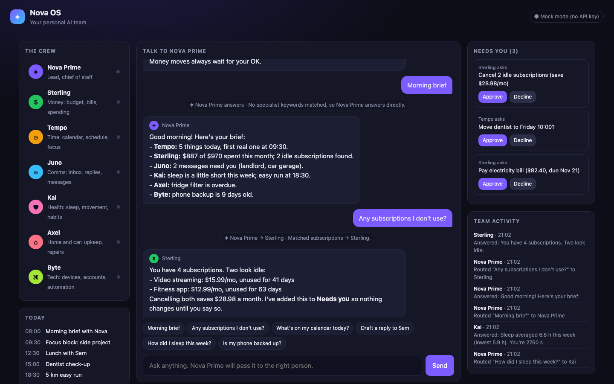
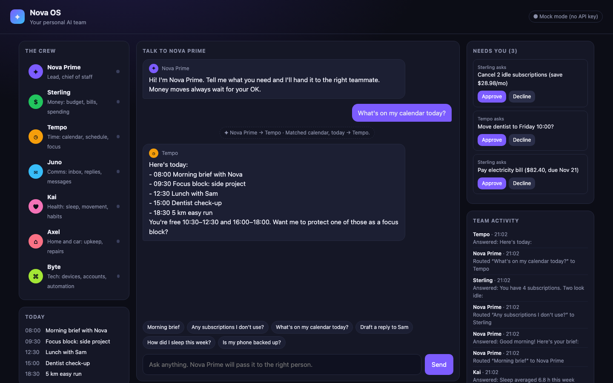
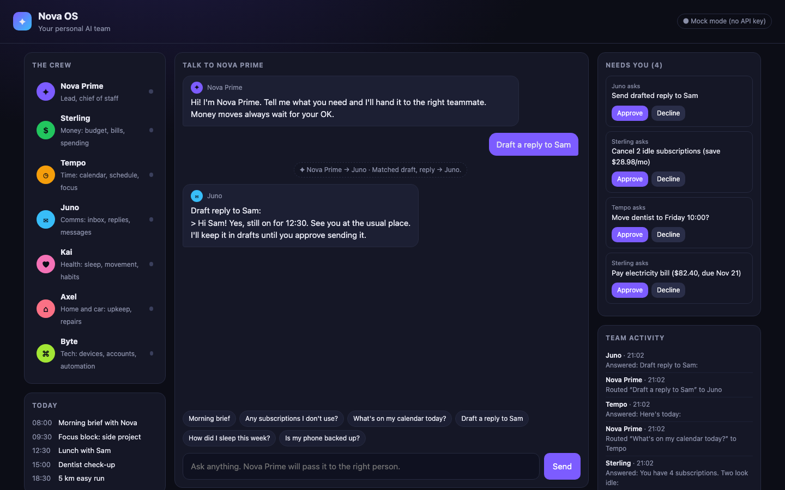
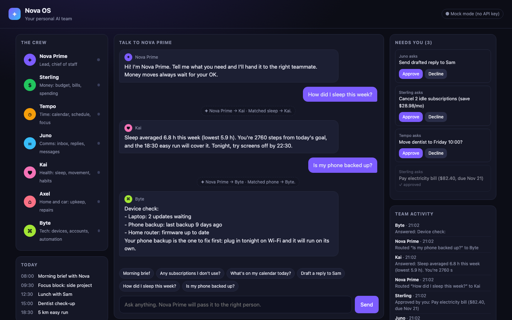
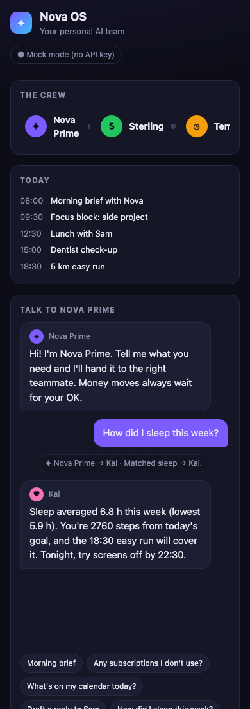
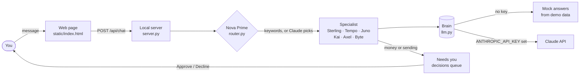

# Nova OS

**A personal AI team that lives with you.** You talk to one lead agent, **Nova Prime**. Nova Prime works out who on the team should handle your request and hands it over. Anything that spends money or sends something on your behalf waits in **Needs you** until you tap Approve.



- **Runs with one command**, Python standard library only (nothing to install).
- **Works with no API key.** Mock mode gives scripted answers from made-up demo data.
- **Optional Claude mode.** Set `ANTHROPIC_API_KEY` and Claude both picks the specialist and writes the answer.
- **You stay in charge.** Money moves and outgoing messages become decisions, never silent actions.

## The crew

| Agent | Looks after |
|---|---|
| ✦ **Nova Prime** | The lead. Routes every request and answers general questions. |
| $ **Sterling** | Money: budget, bills, subscriptions. Never pays on its own. |
| ◷ **Tempo** | Time: calendar, free slots, focus blocks. |
| ✉ **Juno** | Messages: inbox triage, draft replies. |
| ♥ **Kai** | Health habits: sleep, steps, runs (general tips, not medical advice). |
| ⌂ **Axel** | Home and car upkeep. |
| ⌘ **Byte** | Devices, backups, small automations. |

## Quick start

Needs Python 3.9 or newer.

```bash
git clone https://github.com/chamu262/nova-os.git && cd nova-os
python3 -m nova
```

Open <http://127.0.0.1:7878>. That's mock mode: no key, no cost, all demo data.

**Claude mode (optional):**

```bash
export ANTHROPIC_API_KEY=your-key-here   # from console.anthropic.com
python3 -m nova
```

The badge in the top right shows which mode you're in. Other settings are in [`.env.example`](.env.example): `NOVA_MODEL` picks the model, `NOVA_MODE=mock` forces mock mode, `PORT` changes the port.

**Run the tests:**

```bash
python3 -m unittest -v
```

## Screenshots

| Calendar question goes to Tempo | Juno drafts a reply and waits for approval |
|---|---|
|  |  |

| Routing trace and decisions | On a phone |
|---|---|
|  |  |

## How it works



1. **Routing** ([`nova/router.py`](nova/router.py)). In mock mode Nova Prime scores each specialist by keywords in your message. No match, or a tie, and Nova Prime answers itself. In Claude mode Claude picks the specialist; if its reply isn't a known agent, the keyword choice is used.
2. **Answering** ([`nova/llm.py`](nova/llm.py)). Mock and Claude brains share one interface. Each specialist gets its own persona (a short description of who it is) plus only its slice of the demo data. If the Claude API can't be reached, you get the mock answer with a note, so the app never breaks.
3. **Decisions** ([`nova/team.py`](nova/team.py)). Some requests (cancelling subscriptions, sending a reply) add an item to **Needs you**. Nothing happens until you approve. Every step is written to the **Team activity** feed.

Tip: `http://127.0.0.1:7878/?ask=Morning%20brief|How%20did%20I%20sleep%3F` asks those questions on load, which is handy for demos.

## Project layout

Each folder has its own README: [nova/](nova/README.md), [nova/static/](nova/static/README.md), [tests/](tests/README.md), [docs/](docs/README.md), [.github/](.github/README.md).

```
nova/
  agents.py      the crew: names, roles, keywords, personas
  router.py      Nova Prime's routing
  llm.py         mock brain and Claude brain
  team.py        handles a request end to end, keeps decisions and activity
  server.py      local web server and JSON API
  demo_data.py   made-up data (calendar, bills, inbox, ...)
  static/        the single-page web app
tests/           unit and HTTP tests (run with python3 -m unittest)
```

## API

| Method | Path | What it does |
|---|---|---|
| GET | `/api/state` | Crew, decisions, activity, today's plan |
| POST | `/api/chat` | `{"message": "..."}` → which agent, why, and the reply |
| POST | `/api/decisions/<id>` | `{"approve": true}` or `false` |
| GET | `/api/health` | Mode check |

## Notes

- All data is made up and lives in memory, so a restart resets it.
- No real accounts are connected. Hooking up a real calendar or inbox would mean swapping `demo_data.py` for real connectors.

## License

[MIT](LICENSE)
