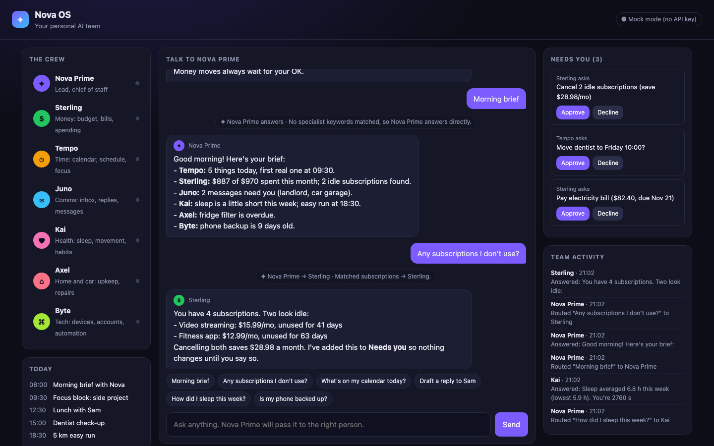

# `nova/`: the app

This is the whole Nova OS program, a Python package that uses only the standard library. Start it with `python3 -m nova` from the repo root.

## Files

| File | What it does |
|---|---|
| `__main__.py` | Runs when you type `python3 -m nova`. Reads `--port` and `--host`, then starts the server. |
| `__init__.py` | Marks the folder as a package and holds the version number. |
| `agents.py` | Defines the crew: each agent's name, role, colour, icon, the keywords that route to it, and its persona (a short "who you are" prompt). |
| `router.py` | Nova Prime's routing. Scores each specialist by keywords in your message. No match or a tie means Nova Prime answers itself. Also holds the prompt Claude gets when it picks the agent. |
| `llm.py` | The "brain". `MockLLM` gives scripted answers from demo data (no key needed). `ClaudeLLM` calls the Claude API when `ANTHROPIC_API_KEY` is set. `make_llm()` picks one. |
| `team.py` | Handles one request end to end: route it, give the specialist only its own slice of data, get the answer, add a "Needs you" decision if the request spends money or sends something, and log the activity. |
| `server.py` | A small local web server. Serves the page and the JSON API (`/api/state`, `/api/chat`, `/api/decisions/<id>`, `/api/health`). |
| `demo_data.py` | Made-up calendar, bills, subscriptions, inbox, health, home and device data. Nothing here is real. |
| `static/` | The web page you use. See [static/README.md](static/README.md). |

## The agents

All seven are defined in `agents.py`.

| Agent | Job | Example question | Can create a decision? |
|---|---|---|---|
| **Nova Prime** | The lead. Receives every message, picks who answers, handles general questions and the morning brief. | "Morning brief" | No |
| **Sterling** | Money: budget, bills, subscriptions. Never pays or cancels on its own. | "Any subscriptions I don't use?" | Yes: cancelling subscriptions |
| **Tempo** | Time: today's plan and free slots. | "What's on my calendar today?" | Comes with a sample one (move dentist) |
| **Juno** | Messages: inbox triage, draft replies. | "Draft a reply to Sam" | Yes: sending the draft |
| **Kai** | Health habits: sleep, steps, runs. General tips, not medical advice. | "How did I sleep this week?" | No |
| **Axel** | Home and car upkeep. | "When is the car oil change due?" | No |
| **Byte** | Devices, backups, small automations. | "Is my phone backed up?" | No |

## How a message flows

`static/index.html` → `server.py` → `team.py` → `router.py` picks an agent → `llm.py` writes the answer → back to the page, plus a decision in "Needs you" when one is needed.
