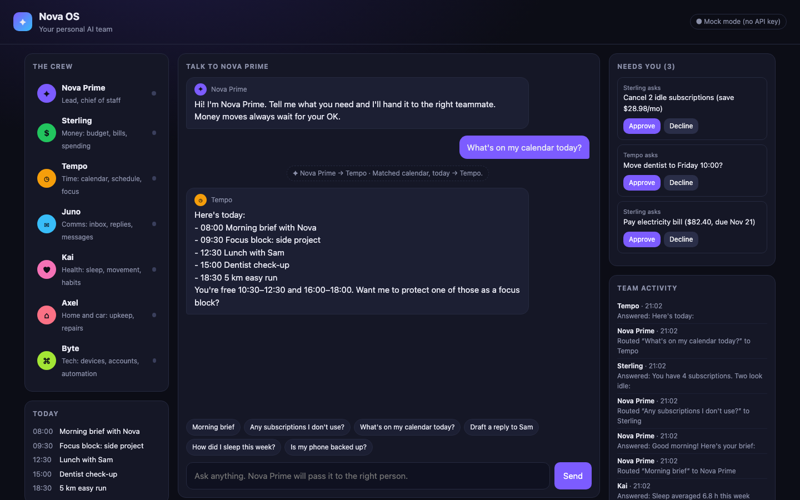
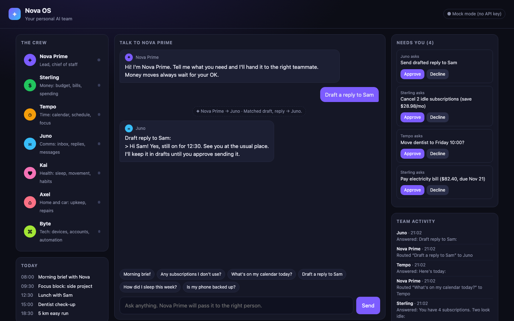
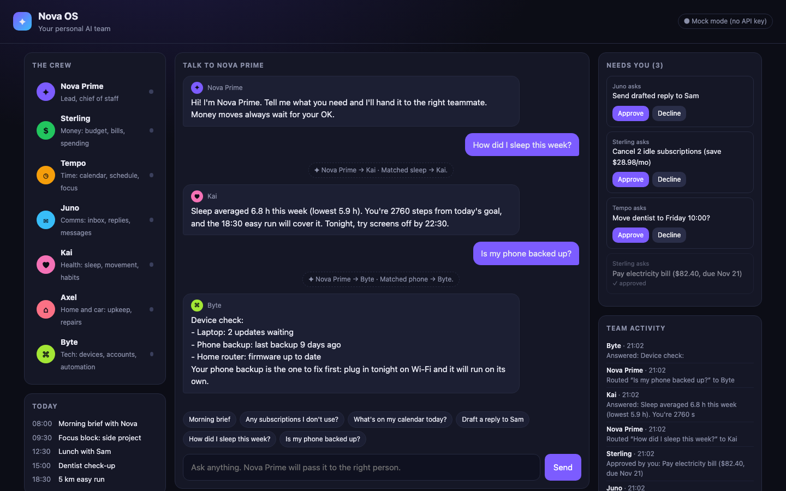
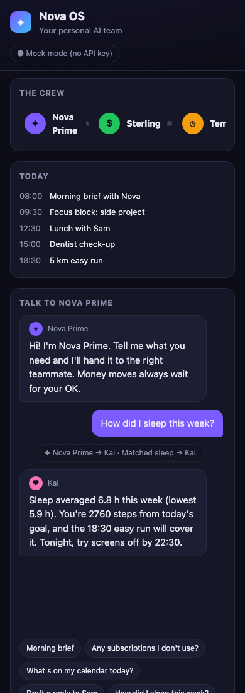

# `nova/static/`: the web page

This folder has one file, `index.html`: the whole user interface, with its HTML, CSS and JavaScript inline. It has no build step and loads nothing from the internet. `server.py` serves it at `/`.

## What's on the page

- **The crew** (left): the seven agents. The one working on your message lights up.
- **Today** (left): the demo calendar.
- **Talk to Nova Prime** (middle): the chat. Each answer has a small line saying which agent Nova Prime picked and why. The quick-question buttons send common questions.
- **Needs you** (right): decisions waiting for Approve or Decline.
- **Team activity** (right): the latest things the team did.
- **Mode badge** (top right): shows mock mode or Claude mode.

On narrow screens the columns stack into one.

## How it talks to the server

It fetches `/api/state` to draw the page, posts to `/api/chat` when you send a message, and posts to `/api/decisions/<id>` when you approve or decline.

Adding `?ask=First%20question|Second%20question` to the address asks those questions on load. That is how the screenshots were made.

## Screenshots (demo data)

| Tempo answers a calendar question | Juno drafts a reply and waits for your OK |
|---|---|
|  |  |

| Routing trace and decisions | Phone layout |
|---|---|
|  |  |
